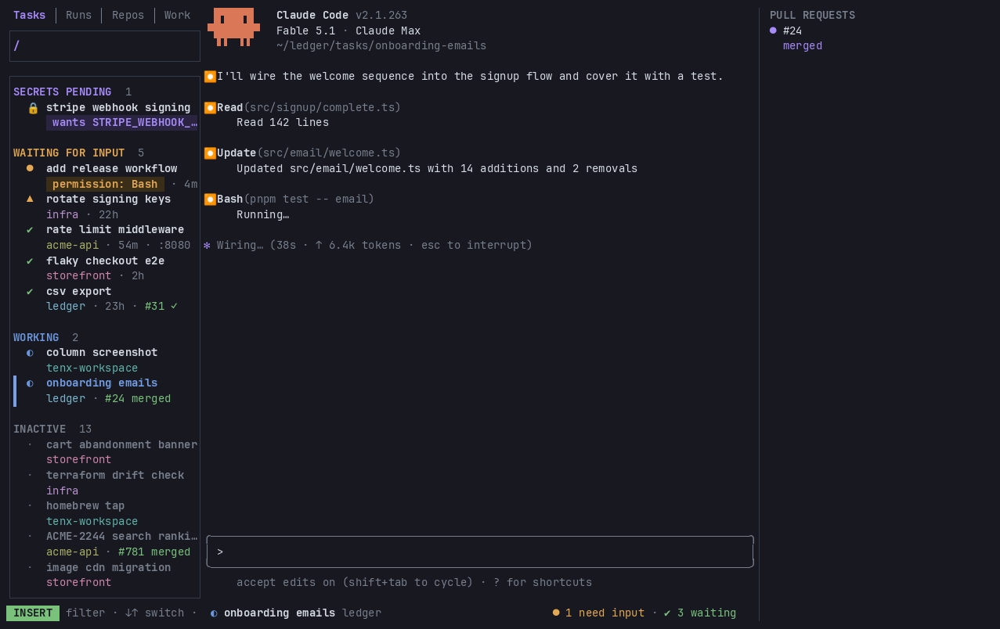

<p align="center">
  
</p>

<p align="center">Work on many tasks in parallel, each with its own coding agent, and always know which one needs you.</p>

Coding agents make it cheap to have several pieces of work in flight at once. The expensive part is everything around them: each task needs its own branch and checkout in every repo it touches, its own agent session, an editor and a shell, and you need to know at a glance which agent is stuck waiting on you and which is still working. Switching between five terminal tabs to find out does not scale.

`tenx` turns a task into that whole setup with one command: a **task** gets its own branch and git worktree in every repo of its **workspace**, a `TASK.md` for notes, and a tmux window running a coding agent (Claude Code, Codex, or pi), an editor and a shell. Every task across every workspace lives in one tmux session, and `tenx` shows it beside a column that lists them grouped by what they need from you: waiting for input, working, done, idle. Because it is a tmux session, you can attach from anywhere, including a phone or tablet over SSH, and answer a waiting agent from the couch. Tasks that need nothing get their agent's window swept away and resume exactly where they left off when you come back. And a workspace can run prompts on a timetable — a nightly dependency check, a morning PR sweep — as [scheduled tasks](#scheduled-tasks) that stay out of your task list until one needs you.



## How it works

```
~/work/                        ← a workspace (tenx init)
├── config.toml                  name, repos, optional layout
├── .bare/<repo>.git             one bare clone per repo, shared by all tasks
├── .claude/                     shared Claude Code settings and skills
├── schedules/<name>.toml        scheduled tasks (tenx schedule add)
└── tasks/
    └── fix-login-timeout/       ← a task (tenx task new "Fix login timeout")
        ├── TASK.md              title, description, todos, links
        ├── .claude → ../../.claude
        ├── api/                 worktree of api on branch fix-login-timeout
        └── web/                 worktree of web on branch fix-login-timeout
```

Each task is a tmux window named after its slug. By default the agent fills the window, and a shell and nvim (opened on `TASK.md`) are tabs in a strip at the top of the window: `Alt+1` agent, `Alt+2` shell, `Alt+3` nvim (or `Ctrl+1/2/3`), or click or tap a tab in `tenx` and `tenx web`. A tab starts the first time you open it, and typing `exit` in the shell brings the agent back. `layout = "split"` keeps the older layout (`claude` on the left, `nvim TASK.md` top-right, a shell bottom-right), and a workspace can supply its own layout script instead.

A task's state is derived live, never recorded:

| State | Meaning |
|---|---|
| Blocked | Claude is waiting on a prompt or permission. You get a desktop notification. |
| Signaled | Something in the window rang the terminal bell (`printf '\a'`). |
| Working | Claude is mid-turn. Shown as ⧗: the turn is over, but Claude waits on a background script it started and carries on when the script ends. |
| Done | Claude finished its turn and nothing has happened since. |
| Idle | No live Claude session in the task. |

A session's subagents are listed under their task, one line each — Claude Code's (what its `Agent` tool spawns, in the foreground or the background), Codex's (`spawn_agent`), and pi's (the child `pi` process a subagent extension runs): `●` waiting on you, `◐` running, `✔` finished (for as long as Claude lists it, about 30 seconds). A subagent waiting on a permission prompt makes its task Blocked, and a background subagent still running keeps its task Working after the session's own turn has ended. A Claude Code session runs its subagents inside itself and shows one at a time, so the column switches between them the way it switches between tasks: moving the cursor onto a subagent's line puts that subagent's view in the task's pane, moving it back onto the task's line puts the main conversation back, and `Enter` moves the keyboard over (tenx walks Claude's agent panel for you; the cursor stays in the column until `Enter`). A Codex or pi subagent has no view to switch to: `Enter` opens its transcript in a tmux window of its own (`↳ <description>`), which `t` does for any subagent and `q` closes. (A pi subagent run with `--no-session`, as pi's example extension does, keeps no transcript to follow.) Codex asks you to trust tenx's two new subagent hooks once, via `/hooks`.

The state comes from tenx's own session registry plus tmux's bell flag. Every supported agent — Claude Code, Codex CLI, and pi — feeds that registry the same way, through its own hooks or extension, so the state model is identical whichever agent a task runs. `tenx agent setup <agent>` installs the integration (Claude Code and pi need no trust step; Codex asks you to trust its hook once via `/hooks`), and `tenx` does it for you on first launch.

## Requirements

- macOS or Linux
- tmux 3.3 or newer
- git

Optional, picked up when present:

- A coding agent: `claude` (Claude Code, the default), `codex` (Codex CLI), or `pi`. The default window layout starts the task's agent — see [Choosing the agent](#choosing-the-agent) for how to set it globally, per workspace, or per task.
- `nvim`. The nvim tab opens `TASK.md` in it.
- `gh`. Shows the task branch's pull request in the sidebar and as a chip in the status bar.
- `lsof`. Shows ports the task's processes are listening on.
- `age` and `sops`. Required only for `tenx secrets`.
- `terminal-notifier` on macOS, `notify-send` on Linux, for desktop notifications. macOS falls back to `osascript`.

## Install

Homebrew (macOS and Linux), which also installs tmux:

```sh
brew install aluedeke/tap/tenx
```

Anywhere else with curl, into `~/.local/bin`:

```sh
curl --proto '=https' --tlsv1.2 -LsSf https://github.com/aluedeke/tenx/releases/latest/download/tenx-cli-installer.sh | sh
```

Prebuilt binaries for macOS and Linux, both Intel and ARM, are on the [releases page](https://github.com/aluedeke/tenx/releases). From source, with a Rust toolchain (1.87 or newer):

```sh
cargo install --locked --git https://github.com/aluedeke/tenx --tag v0.1.0
```

The package is `tenx-cli` (the crates.io name `tenx` belongs to an unrelated project); the binary is `tenx` either way. On a Mac with Apple silicon it also builds `tenx-whisper` (speech to text for `tenx web`), which compiles whisper.cpp and so needs `cmake` (`brew install cmake`). Every build also makes `tenx-tts` (text to speech for `tenx web`), which downloads sherpa-onnx's prebuilt libraries while it builds. From a checkout, `make install` builds the same, page included. With tenx installed by Homebrew, it puts that build in place of the release, behind the same `$(brew --prefix)/bin/tenx`, and restarts `tenx web` and the watcher — a test version; `make uninstall` goes back to the release, and `make installed` says which one runs. Without Homebrew it installs to `~/.cargo/bin`.

Nothing else to place. tenx generates its own tmux config at `~/.config/tenx/tmux.conf` and runs its own tmux server on a dedicated socket, so your `~/.tmux.conf` is untouched.

### Upgrading

`brew upgrade tenx`, or run the installer again. A running tenx server keeps the config it started with, so after an upgrade `tenx` tells you to load the new one:

```sh
tenx tmux reload
```

Nothing is closed: every window, pane and program keeps running, and the background watcher is restarted on the new version. A few settings apply only to what starts afterwards — the terminal type and scrollback size to new panes, terminal features to the next attach (quit `tenx` and start it again). Restart a running `tenx` client or `tenx web` yourself to run the new binary there too.

When a reload is not enough (a new tmux version), `tenx tmux restart` stops the server and builds it again: every window in order with its layout, every agent resuming its conversation, the programs the layout started (nvim on `TASK.md`) running again, and a fresh shell in the same folder for each shell pane. Programs you started in a shell yourself (a dev server, a test run) are stopped; the command lists them and you start them again. It waits until no task is working or waiting on a prompt first (`--now` skips that), and a running `tenx` and open `tenx web` tabs reconnect by themselves.

After an agent update (a new Claude Code, Codex or pi), use `tenx agent restart` instead (see [Sweep, pin and restart](#sweep-pin-and-restart)).

## Quickstart

```sh
mkdir ~/work && cd ~/work
tenx init                          # asks for repo URLs, clones them, offers the Claude Code skills
tenx task new "Fix login timeout"  # branch + worktree per repo, TASK.md, tmux window
tenx                               # attach to the session
```

Inside the session:

- `Ctrl+w` puts the cursor in the column, on the task you are in; pressed again from the column, it hides it. On a phone the column is hidden and `Ctrl+w` shows the list full screen.
- `tenx` from a task's shell does the same.
- `tenx` from any other terminal attaches to the same session.

When you are done with a task:

```sh
tenx task rm fix-login-timeout     # removes worktrees, branches and the window
```

## The column

The column lists every task from every registered workspace, sectioned by attention: secrets pending, waiting for input, working, inactive. It is Telescope-style: typing filters, and the list has its own keys. A task waiting on a permission prompt can be answered from the column with `A` or `D`: the answer is typed into the task's pane by tmux, and only after tenx has checked that the session is still waiting on a permission dialog and that the dialog is still on screen; anything else (a question from Claude, a prompt already answered) is refused with a message, so `Enter` never lands somewhere unintended.

| Key | Action |
|---|---|
| `Ctrl+w` | Into the column, on the task you are in; from the column, hide it |
| `↓`, `↑`, `j`, `k`, `gg`, `G` | Move; an open task shows as you land on it; landing on a Claude subagent shows it in the task's pane, landing on the task shows main again |
| `n` | Next task that needs you (blocked, rang the bell, or secrets pending), cycling |
| `Enter`, `o`, `l` | Open the task, creating its window if needed, and put the cursor in it; on a subagent, the same for its view (or its transcript, once Claude no longer lists it) |
| `t` | On a subagent: follow its transcript in a tmux window; on a scheduled run, its agent's transcript, read-only |
| `s` | Show or hide the sidebar: the task's links with their state, git, todos |
| `P` | Promote a scheduled run to a normal task: it moves to the Tasks tab and its schedule lets go of it |
| `L` | The task's links in a box: its PRs, the Artifact pages and Claude Design projects its agent made, its Linear issue, its ports, other pages it named. `1`–`9` or `Enter` opens one, `y` copies it |
| `Esc`, `q`, `Ctrl+c` | Back to the task, leaving the column showing |
| `/`, `i` | To the search field |
| `Tab`, `Shift+Tab`, `gt`, `gT` | Switch between the Tasks, Runs, Repos and Work tabs |
| `Ctrl+n` | New task, from the list or the task screen; give it a prompt and the agent starts on it, leave the name empty and Claude names it from the prompt |
| `Ctrl+Shift+n` | Quick task: type a prompt, `Enter`, and a session in the adhoc workspace starts on it, named by Claude (needs a terminal that reports Shift with Ctrl, like kitty, Ghostty or iTerm2; elsewhere it opens the new-task form) |
| `a` | Add a repo to the workspace (Repos tab) |
| `W` | New workspace |
| `e` | Edit which repos the task has worktrees for |
| `r` | Rename the task |
| `x` | Close the task's window (the conversation resumes on next open) |
| `p` | Pin / unpin the task: sweep never closes a pinned task's window (📌 on its row) |
| `u` | Unlock pending secrets |
| `A`, `D` | Approve or deny the task's permission prompt without visiting it |
| `D` on a secrets row | Reject its pending secrets requests, with an optional note for the agent |
| `dd` | Delete the task |
| `?` | Every key and command, in the column (also `:help`) |
| `:` | Command line, see below |

The column opens in the search field (`Ctrl+w` lands in the list instead). Typing filters the list; `Backspace` edits the filter; `Esc` or `↓` leaves the field for the list. `↓` and `↑` from the field land next to the task you are in, not at the top, and `Ctrl+j`/`Ctrl+k` do the same. `Enter` in the field opens the top match. In the list, `↑` from the first row goes back to the field. `Ctrl+w` lands in the list, so `Ctrl+w` `n` from any task reaches the next one that needs you, and `A` or `Enter` deals with it.

**The sidebar**, right of the task, shows what the task is about: the open todos from `TASK.md` with a progress bar, then its links grouped — pull requests (its own and the ones it links to) with their state (a square per check, the review, comments and how many are unresolved, merged), Linear issues with their status, Claude Design projects and artifacts, Slack messages —, each repo's git state (commits, uncommitted changes, what isn't pushed, how far main has moved on), and other pages and running ports last. A click opens a link. `s` in the column (or `:sidebar`) shows and hides it; it needs a terminal wide enough to leave the task 80 columns. In `tenx web` the header's right-most button shows it, as a panel right of the terminal, or as a drawer over it on a phone or a tablet in portrait — where the left-most button opens the task list the same way from the left. On a desktop or an iPad, drag the sidebar's left edge (on touch, its grip) to make it wider or narrower — as wide as leaves the task 80 columns; the browser remembers it, and a double-click or double-tap on the edge goes back to 300 px. The task list's right edge works the same way, up to half the page; a double-click goes back to the automatic width. Linear's status needs an API key: `tenx linear login` asks for a personal API key (Linear → Settings → Security & access) and keeps it in `~/.config/tenx/linear-token`. Without one, the sidebar names an issue from its link: Linear puts the title in it (`…/issue/ENG-417/errors-sort-by-column` → "ENG-417 Errors sort by column"), as it was when the link was copied and sometimes cut short; a link with only the number shows only the number.

Links open in the browser of the machine the client runs on; over SSH there is none of yours there, so `L` and the sidebar copy the link to your terminal's clipboard instead (OSC 52). tenx finds a task's links in the `## Links` section of its `TASK.md` and in its agent's replies — not in tool output, where a "list my projects" result alone carries dozens of unrelated links — and keeps the newest ten of each kind. In `tenx web` the sidebar lists the current task's links, and a row's menu has them too.

The **Repos** tab lists every workspace's repos with their clone status and last commit. `a` adds a repo there; `:n` creates a task, starting in the selected repo's workspace; the task keys tell you to switch back (`gt`) for anything else. `W` (or `:init [path]`), from either tab, creates a whole new workspace: a path, a name, a first repo URL and whether to install the skills, the same questions `tenx init` asks. The column then lands on the new workspace's repo in the Repos tab, where `Ctrl+n` creates its first task; given no repo, it opens the add-repo form for it instead, since a task with no repo to work on is rarely what a new workspace is for.

The **command line** (`:`) takes a verb and runs it on the selected task. Every key above has a verb: `:new`, `:open`, `:rename`, `:edit-repos` (`:e`), `:close` (`:x`), `:unlock` (`:u`), `:approve` (`:a`, `:allow`), `:deny`, `:delete` (`:d`, `:rm`), `:next`, `:init [path]`. The rest have no key: `:ask <question>` starts a detached session on the question (see [Sessions outside a repo](#sessions-outside-a-repo)), `:agent` shows the task's agent and `:agent <kind>` or `:agent default` sets it, `:reject` rejects a pending secrets request (what `D` does on a secrets row), `:cancel` withdraws one, `:tasks`, `:runs`, `:repos` and `:work` switch tabs, `:hide` hides the column, `:help` lists every key, `:q` quits the client.

The **forms** (new task, new workspace, add repo, edit repos, rename, delete) are keyboard-only. `Tab`/`↓` and `Shift+Tab`/`↑` move between fields, `Space` toggles a repo, `Enter` submits, `Esc` cancels. In the new-task form, the workspace starts as the selected item's and `←`/`→` on that field move it to another registered workspace (the repo list follows), and `←`/`→` on the agent field cycle the choice; in the new-workspace form, `Space` on the skills field toggles it. In the edit-repos form, `j`/`k` also move, `x` also toggles, `a` picks every repo and `n` none. Deleting a task, or removing a worktree from the edit-repos form, asks once more; `y` or `Enter` confirms, any other key cancels.

The **mouse** selects but never opens: the wheel scrolls the view without moving the selection, a click on a row selects it (and switches to its window when open), a click on the search box or a tab header focuses that. Opening stays on `Enter`, so a tap on a phone with a desktop client attached can't switch the desktop's window.


`tenx` in a terminal is one process that owns it: the task list as a column on the left, about a fifth of the width, and the tmux session on the right through an embedded terminal, the layout cmux made familiar. tmux stays underneath exactly as before, so the session, the watcher, sweep and secrets are untouched, quitting the client leaves everything running, and a second terminal, or a phone over SSH, gets a column of its own.

Each task takes two lines: the title, then a muted line with what it is waiting on, its workspace, and how long it has been resting, as far as they fit. A task's links are in the sidebar. Closed tasks are drawn dimmer. The column has the column's keys, minus the preview panel, since the task itself is right there.

`Ctrl+w` puts the cursor in the column on the task you are in; `Ctrl+w` from inside hides the column and gives the width back. The arrow keys and `j`/`k` step through every task: landing on an open one switches to it, landing on a closed one shows an empty screen in its place until `Enter` opens it. `Enter` opens a task and puts the cursor in it; `Esc` or `q` puts the cursor back without switching; `/` types a filter; `:hide` hides the column; `:q` quits the client. Because the column is one process, its selection and filter survive switching tasks, and it re-groups itself as statuses change only while the keyboard is in the task, never while you are moving through the list. On a terminal under 100 columns the column is hidden and `Ctrl+w` shows the list over the whole screen.

## Commands

```
tenx                     the column beside the session, creating the session if needed
tenx init [NAME]         create a workspace here (or in NAME/)
tenx repo add <URL>      add a repo to the workspace (bare clone)
tenx repo list|fetch
tenx task new <TITLE>    create a task [--repos a,b | --no-repos | --adhoc] [--prompt ..] [--description ..]
                         [--link "Label: value"] [--no-open | --no-focus]
                         [--agent ..] [--agent-args ".."] [--confirm-dev-channels]
tenx ask <QUESTION>      a session of its own for a question, outside any workspace
tenx task open <NAME>    open or switch to a task's window [--no-focus: open it, switch nobody to it]
tenx task send <SLUG> <TEXT>   message a task's agent, as if typed into its pane
tenx task wait <SLUG>    until its turn is over [--timeout 10m]; exits 2 if it needs you, 3 on timeout
tenx task output <SLUG>  what its agent said since the last prompt [--json]
tenx task list
tenx task rename <SLUG> <TITLE>
tenx task add-repo|rm-repo|set-repos <SLUG> <REPOS..>
tenx task rm <NAME>
tenx task pin|unpin <NAME>
tenx task agent <SLUG> [AGENT]  show or set its agent [--args ".." | --clear-args] [--[no-]confirm-dev-channels]
tenx task sweep          close windows nobody is waiting on [--after 8h] [--idle-after 15m] [--dry-run]
tenx agent restart       restart every open task's agent in place [TASK..] [--now] [--timeout 30m] [--dry-run]
tenx tmux reload         load this tenx's tmux config into the running server
tenx tmux restart        stop the tmux server and build it again as it was [--now] [--timeout 30m] [--dry-run]
tenx watch               the attention watcher (started automatically)
tenx standup             summarize recent activity across tasks
tenx schedule add <NAME> a scheduled task (--cron ".." | --every 4h) --prompt ".." [--task SLUG | --repos a,b]
                         [--agent-args ".."] [--timeout 1h] [--catch-up 12h] [--keep 3] [--keep-failed 5]
tenx schedule list|runs [NAME]|run <NAME>|pause|resume|rm <NAME>   see Scheduled tasks
tenx secrets ...         per-task encrypted secrets, see below
```

Every mutating command accepts `--ws-dir` (a workspace directory, or a registered workspace's name) so scripts and other front ends can run it from anywhere. `tenx task list --json` is the same data the column renders.

## Sessions outside a repo

Not every session is about one task's code. Two kinds don't need worktrees:

- **A task without repos.** `tenx task new "Why is CI slow" --no-repos` (or untick every repo in the column's new-task form) makes a task whose agent runs in the bare task directory, in a window of its own with no editor or shell beside it, and can read the whole workspace — every other task's code included.
- **An adhoc session.** `tenx ask "how do I rebase onto a moved branch?"`, or `:ask …` in the column, starts a session titled after the question, with the question as its first message, in the **adhoc** workspace — one tenx creates for itself at `~/.local/share/tenx/adhoc` (`adhoc_dir` in the global config moves it). tenx 0.2.3 and earlier called it *detached* and kept it at `~/.local/share/tenx/detached`; it moves to the new place, conversations included, the first time tenx starts with none of its sessions open. It has no repos, and its sessions can read every registered workspace. Asking the same thing twice gives a second session (`-2`) rather than an error.

Both are ordinary tasks everywhere else: listed in the column, with status, notifications, sweep and secrets. Sweep only closes their windows; nothing deletes them but you.

### Orchestrating other tasks

An adhoc session can drive tasks in other workspaces. It gets an `/orchestrate` skill and permission to run the commands that do it, without asking:

```sh
tenx task new "Bump the SDK" --ws-dir work --no-focus --prompt "Upgrade to SDK 5, fix what breaks, open a PR"
tenx task send bump-the-sdk --ws-dir work "Also update the changelog"
tenx task wait bump-the-sdk --ws-dir work      # 0 done · 2 needs you (prints why) · 3 timed out
tenx task output bump-the-sdk --ws-dir work    # what it said since the last prompt
```

A message is pasted into the task's live agent, so every exchange is visible in its window and you can take over at any point. `send` opens a closed task with the message as its first prompt, and refuses to type into an agent that is waiting on a dialog (`--force` overrides). It never answers a permission prompt; that stays with you. The permission rules are seeded once into the adhoc workspace's `.claude/settings.json`, which you can edit.

## Scheduled tasks

A schedule runs a prompt in a workspace on a timetable: a nightly dependency check, a weekly cleanup, a look at your open PRs every morning.

```sh
tenx schedule add nightly-deps --cron "0 6 * * 1-5" --title "Nightly dependency check" \
  --prompt "Run cargo outdated and open a PR if a bump is safe. Last run: {last_run} ({last_run_pr})" \
  --repos tenx --agent-args "--permission-mode acceptEdits --allowedTools 'Bash(cargo *)'"
```

Each schedule is one file, `<workspace>/schedules/<name>.toml`, which you can also write by hand:

```toml
title = "Nightly dependency check"
cron = "0 6 * * 1-5"       # local time; or @daily, @weekly …, or: every = "4h"
prompt = "Run cargo outdated …  {date}, {last_run} and {last_run_pr} are filled in"
repos = ["tenx"]           # each run is a fresh task with these worktrees (default: all)
# target = "my-task"       # instead: send the prompt to this existing task
agent_args = "--permission-mode acceptEdits"
timeout = "1h"             # the default; "0" = never
catch_up = "12h"           # a slot missed by less than this runs once afterwards
keep_ok = 3                # finished runs kept; older ones with nothing to lose are deleted
keep_failed = 5
# secrets = ["GH_TOKEN"]   # with target only, see below
paused = false
```

**Runs.** When a slot comes, a run starts: a task of its own, named after the schedule and the slot (`nightly-dependency-check-2026-11-08-06-00`), with its agent started on the prompt, or the prompt sent to the `target` task. At most five runs go on at once; a due run waits for a place. A slot is skipped while the schedule's previous run is still going. The agent can say it found nothing worth your time with `tenx schedule quiet`; the `/tenx` skill tells it so.

**Out of your way.** Runs are not on the Tasks tab, the status bar or `tenx task list`. The column's **Runs** tab lists them per schedule, newest first, with how each ended — done, nothing to report, timed out, failed — and a `[n]` of the ones you haven't opened. `t` reads a run's transcript without waking its agent, `Enter` opens it, `P` turns it into a normal task to carry on with. A run that waits on you (a permission prompt, a question) is on the Tasks tab, notified like any task, until it carries on. `tenx schedule runs [name]` lists the same, and a schedule's history (`schedules/.state/<name>.jsonl`) keeps every run and skipped slot after the runs themselves are gone.

**Unattended.** A run has no one to click "allow". Give its agent what it may do with `agent_args`; `tenx schedule add` warns when you don't. Every run stops after its `timeout`, time spent waiting on you included: tenx interrupts the agent, and closes a run's own window 30 seconds later. Nothing on disk is deleted. Secrets are released only by a person typing the passphrase into an open window, so a fresh run never has any: a schedule that needs secrets sends its prompt to an existing task (`target`) and lists them under `secrets`, and a slot is skipped, with the reason recorded, while one isn't released there.

**Cleanup.** Past `keep_ok` finished or `keep_failed` failed runs, the oldest are deleted, but only when they have nothing to lose: no uncommitted change, no commit that isn't on a remote, no open PR, not pinned.

**When it runs.** The watcher checks the schedules once a minute, so runs start while the tenx tmux server is up — closing every terminal doesn't stop it, a reboot does. On a machine you don't sit at, `tenx web service install` starts the server and the watcher at login (with auto-login, after every reboot). A slot missed while tenx was down runs once when it is back, if it is less than `catch_up` old; older ones are recorded as missed. On macOS the watcher keeps the machine from idle sleep while a run goes on.

**Safety.** A schedule an agent adds (`tenx schedule add` from its shell tool, which has no terminal) is written paused, and only a person can turn it on, with `tenx schedule resume <name>` in a terminal. `tenx schedule pause --all` stops every schedule at once.

```
tenx schedule list [--json]          every schedule: when, next run, last outcome
tenx schedule runs [NAME] [--json]   runs, newest first; with a name, its history too
tenx schedule run <NAME>             start a run now, to try a schedule out
tenx schedule pause|resume <NAME>    (--all for every schedule)
tenx schedule rm <NAME>              delete a schedule; its runs and history stay
tenx schedule quiet                  inside a run: nothing to report
tenx schedule promote [TASK]         make a run a normal task
```

## From a phone or tablet

Everything runs in one tmux session on one machine, so any terminal that can SSH there can take over:

```sh
ssh devbox -t tenx
```

On a terminal under 100 columns there is no room for a column beside the task, so the task takes the whole screen and `Ctrl+w` shows the list over it. The rows are the same two lines per task, so titles and status glyphs stay readable on a 40-column phone screen, and a permission prompt can be answered with `A` from the list. Opening a task gives you the agent's whole screen, where you can answer anything else and detach again. The desktop notification goes to the machine running the session, not to the phone.

## Web UI

`tenx web` serves the same column as a web page, beside a terminal attached to the session (xterm.js), for a browser on the desktop or a phone:

```sh
tenx web              # prints http://127.0.0.1:7070/?token=… — open that once
tenx web --open       # and opens it
```

Each browser tab switches tasks on its own, without moving your terminal client, and takes the same keys as the terminal client — `Ctrl+w` for the column (or the header's `☰`; the header also names the task you're in and holds next-that-needs-you, the speaker, the microphone, new task, and behind `⋯` notifications and `?`), `?` for the rest (`Alt+w`/`Alt+n`/`Alt+Shift+n` where the browser keeps `Ctrl+w`/`Ctrl+n`/`Ctrl+Shift+n`). The header's `+` offers the quick task and the new-task form. On a phone a task shows its agent alone (the window's agent pane, zoomed); `Ctrl+b z` (the key bar's `ctrl`, then `b`, then `z`) shows every pane again, and `Ctrl+b o` goes to the next pane. A reload or a dropped connection within 30 s comes back to the same place.

The address carries a token (`~/.config/tenx/web-token`, readable only by you) that the page swaps for a cookie; `tenx web --rotate-token` replaces it and logs every browser out. The page is a shell on this machine, so by default it listens on `127.0.0.1` only. To reach it from a phone, put it behind [`tailscale serve`](https://tailscale.com/kb/1312/serve) rather than `--listen 0.0.0.0`, which serves it over plain HTTP. Building from source, `make web` builds the page (Node and pnpm) before `cargo build`; without it the binary serves a placeholder.

To keep it running without a terminal — started at login, restarted if it exits — install it as a service: `tenx web service install [--listen …] [--port …]` (a LaunchAgent on macOS, a systemd user unit on Linux; `tenx web service status`, `tenx web service uninstall`). It logs to `~/.config/tenx/web.log`, and it carries your shell's `PATH` into the unit, since tmux panes it starts inherit its environment. It runs the binary at the path you installed it from (`~/.cargo/bin/tenx`, `/opt/homebrew/bin/tenx`), so an upgrade is: replace that binary, then `tenx web service restart` — `brew upgrade tenx` and `make install` replace it. Run `service install` again only if the binary moves.

### On a phone or tablet, as an app

Behind `tailscale serve` (HTTPS), the page installs as an app: on an iPhone or iPad, Safari's Share → **Add to Home Screen**; on Android or a desktop Chrome/Edge, the install button in the address bar. The installed app signs itself in on first launch and opens full screen.

Tap the bell (🔕) in the column's top bar to get a notification whenever a task starts needing you — the same prompts `tenx` raises desktop notifications for, and never for a finished turn. Tapping one opens that task. On iPhone and iPad, notifications only work in the Home Screen app (iOS 16.4 or newer), not in a Safari tab, and need HTTPS. The app icon's badge counts the tasks waiting on you. Notifications are Web Push: the browser's push service (Apple, Google, Mozilla) carries them, encrypted end to end with keys only the browser and `tenx web` hold (`~/.config/tenx/web-push-vapid` and `web-push-subs.json`, readable only by you); `tenx web` must be running for them to be sent.

A key bar sits above a phone's or tablet's on-screen keyboard: `esc`, `ctrl`, `⇥`, arrows, `⏎`, `→⌘`, `←⌘`, paste and 📎. `→⌘` copies what is on the device's clipboard — text, or an image — to the clipboard of the Mac `tenx web` runs on, so `⌘V` there pastes it; `←⌘` copies the Mac's clipboard to the device's (an image arrives as PNG; in Safari, an image after text or text after an image can take a second tap). Both, like paste, need HTTPS (`tailscale serve`): a browser allows the clipboard only there. On an iPad it shows whenever the terminal has the focus, so it works with a hardware keyboard too. 📎 picks images from the photo library or the camera; paste takes text or an image from the device's clipboard. An image is uploaded to `tenx web` and its path typed at the cursor, which Claude Code attaches as an image. `Ctrl+V` in the terminal does the same from another Apple device: Claude Code alone would look for the image on the clipboard of the machine `tenx web` runs on. In the terminal, a finger drag scrolls, a tap moves the cursor there, and press and hold, then drag, selects text as a mouse drag does; lifting the finger copies it to the device's clipboard.

### Speaking instead of typing

Tap the microphone in the header (or in the key bar above a phone's keyboard, or press `Ctrl+M`), wait for the short chime that says it records, talk, and tap it again: what you said is typed into the terminal at the cursor, not sent, so you can read it before pressing Enter. Pressing Enter while it records stops it and sends the text once it is typed. With the new-task or quick-task form open, what you say goes into the form's prompt field instead, after what is already there, and Enter stops the recording and creates the task. The text is typed while you talk, as iOS dictation types it: when Whisper revises its guess for the last words, or its final pass over a finished sentence corrects one, the changed part is erased with backspaces and typed again. Once you type yourself during a dictation, what it typed before that stays as it is. The page only records and streams; `tenx web` turns the recording into text on its own machine with [whisper.cpp](https://github.com/ggml-org/whisper.cpp), through `tenx-whisper`, a program that ships next to `tenx` on Macs with Apple silicon (Homebrew, the install script and `make install` all include it). Point it at a Whisper model in `~/.config/tenx/config.toml`:

```toml
[speech]
model = "~/models/ggml-large-v3-turbo.bin"   # any whisper.cpp ggml model, e.g. one tuned on your voice
prompt_file = "~/models/glossary.txt"        # optional: names and jargon to expect
language = "auto"                            # optional: a code (en, de) or auto, the default
idle_minutes = 10                            # optional: unload the model after this long unused
```

Download a model from [ggerganov/whisper.cpp on Hugging Face](https://huggingface.co/ggerganov/whisper.cpp) (`ggml-large-v3-turbo.bin` is a good start). `tenx web` starts `tenx-whisper` on the first recording (loading a large model takes a few seconds), restarts it if it dies, and stops it after `idle_minutes`, which gives its memory back; a changed `[speech]` applies to the next recording. Without a model the microphone says how to set one; nothing is transcribed in the browser. On Linux and Intel Macs `tenx-whisper` isn't included; there, and to use a `whisper-server` instead on any machine, set `TENX_WEB_STT_URL` (e.g. `http://127.0.0.1:8178/inference`). A recording without speech is not sent, since Whisper invents text for silence. The microphone needs HTTPS (`tailscale serve`). To choose the language on one device, set `localStorage['tenx.stt.language']` to a code (`de`) or `auto`.

### Hearing the agent's reply

Tap the speaker in the header (or press `Ctrl+.`) to hear the current task's agent read its last reply aloud. Tap it again to pause, and once more to go on; while it reads, ■ takes the microphone's place and stops it. The reply is its last message since your last prompt, with code blocks left out and links read as their text. `tenx web` turns it into speech on its own machine with [Kokoro](https://huggingface.co/hexgrad/Kokoro-82M), an open voice model (Apache 2.0), run by [sherpa-onnx](https://github.com/k2-fsa/sherpa-onnx) in `tenx-tts`, a program that ships next to `tenx` on Macs; on Linux, `cargo install` builds it (glibc only). Nothing leaves the machine. It reads a few sentences at a time, so a long reply starts at once, and the page plays it also with an iPhone's ringer switched to silent. Download the model once (about 330 MB) and point the config at its directory:

```sh
mkdir -p ~/.local/share/tenx/models && cd ~/.local/share/tenx/models
curl -L https://github.com/k2-fsa/sherpa-onnx/releases/download/tts-models/kokoro-multi-lang-v1_0.tar.bz2 | tar xj
```

```toml
[read_aloud]
model = "~/.local/share/tenx/models/kokoro-multi-lang-v1_0"
voice = "af_heart"      # optional: any Kokoro voice — af_*/am_* American, bf_*/bm_* British English, ff_siwis French, …
speed = 1.0             # optional: 1.0 is the voice's own pace
idle_minutes = 10       # optional: unload the model after this long unused
```

The voice's first letter is its language, and Kokoro has no German voice. A changed `[read_aloud]` applies to the next reading. Without a model the speaker says how to set one; nothing is read aloud in the browser.

### Tasks as tools for Claude on the web (MCP)

`tenx web` also serves an [MCP](https://modelcontextprotocol.io) endpoint, `/mcp`, so an agent on another machine — Claude on the web, Claude on your phone — can list your tasks, read what their agents said, start new tasks and send them messages. The tools: `tenx_list_workspaces`, `tenx_list_tasks`, `tenx_get_task` (status, PRs, `TASK.md`), `tenx_get_output` (the agent's last reply), `tenx_read_screen` (the agent pane's last lines), `tenx_create_task`, `tenx_send_message`, `tenx_wait` (up to 60 s per call) `tenx_answer_permission` (approve or deny a permission prompt that is on screen) and `tenx_focus_task` (show a task on your screen, opening its window if it is closed: in the `tenx web` page the call comes from, when the caller names it with a `tenx-session` header, else in your tenx terminals). A new task opens its window without taking your screen; only `tenx_focus_task` moves it. A tool names its task by slug, `workspace/slug`, title or a few words of the title, the workspace optional — so an agent acts on the task you name without listing every task first — and `tenx_list_tasks` takes such words as `query`. `tenx_send_message` returns as soon as the message is typed; a `tenx_wait` right after waits for that turn.

A client that keeps the MCP session `initialize` gives it (`Mcp-Session-Id`) doesn't have to poll: it opens the event stream (`GET /mcp`), picks what it wants with `tenx_subscribe` — `attention` (a task started needing you: the same moments your phone gets a notification for), `turn` (an agent finished a turn, with its reply), `reply` (the answer to a message this client sent; `tenx_send_message` returns a `message_id`) and `focus` (the task on a screen changed) — and hears each as a `notifications/tenx/event`, resuming after a dropped connection with `Last-Event-ID`. `tenx_current_task` says what a screen shows right now. The details are in `docs/web-protocol.md`.

It is not for a browser: it takes a bearer token of its own (`~/.config/tenx/mcp-token`, readable only by you; `tenx web mcp-token` prints it, `--rotate` replaces it and needs a `tenx web service restart`), never the page's cookie, and refuses any request with an `Origin` header. Sending a message to an agent is as good as running commands on this machine, so never put `/mcp` on the internet directly: reach it over your tailnet (`tailscale serve`), behind a gateway that logs you in first (for claude.ai: Cloudflare Access with OAuth in front of a gateway that checks Access's token and adds `Authorization: Bearer <mcp-token>`), and keep "ask before use" on for the tools that write.

## Sweep, pin and restart

Every open task window holds a resident `claude` process. `tenx task sweep` closes windows nobody is waiting on: idle tasks once they have been quiet for `--idle-after` (default 15m), finished tasks after `--after` (default 8h). A task's window is the one its panes are actually in, never just one that shares its slug — the same task name in two workspaces must not close the wrong session. It never touches the current window, a pinned task, or a task that is blocked or working, and it deletes nothing. The home column runs a rate-limited sweep in the background. `tenx task pin` exempts a task.

After an agent update, or a change to its config, `tenx agent restart` restarts the agent in every open task window without losing anything tenx shows. Only the agent's pane is replaced (`tmux respawn-pane`), so the window, its other panes and its layout stay. The conversation is resumed by its session id (`claude --resume`, `codex resume`, `pi --session`), not "the newest one in this folder". Each task is restarted as soon as it is quiet: a running turn or an open permission prompt is waited out, up to `--timeout`, and `--now` skips the wait and tells the interrupted agents to continue. A task that was done keeps its age. An agent that asks for the restart itself is restarted last and continues on its own. Closed tasks are left alone; they start the new version when opened.

## Agent integration

tenx supports Claude Code, Codex CLI, and pi, and treats them uniformly.

- **State.** Each agent reports its status to tenx's session registry through its own hooks (Claude Code, Codex) or a small extension (pi). `tenx agent setup <agent>` installs the integration and `tenx doctor` reports what is wired up, including repo settings or MCP servers (`.claude/settings.json`, `.mcp.json`) a task's Claude can't load because it starts in the task directory, not the repo (each repo's `CLAUDE.md`, skills, subagents and commands do load); a Codex task also gets its directory trusted in `~/.codex/config.toml` when it opens.
- **Skills.** `tenx init` offers to install `/tenx` and `/standup` into `.claude/skills/` (for Claude Code) and a portable copy into `.agents/skills/` (for Codex and pi), plus an `AGENTS.md`. `/tenx` teaches a session about the workspace layout, creating tasks from tickets, and requesting secrets; `/standup` formats `tenx standup`. Launching `tenx` keeps them current in every registered workspace. A file you've edited is left alone, `tenx doctor` lists it, and `tenx doctor --reset-skills` takes the current version and keeps yours as `.orig`.
- **Status.** Each task window shows its state in the tmux status bar, with the agent named when it isn't the default; the right corner counts tasks needing you in other windows.
- **Background agents.** A non-interactive session (`codex exec`, `claude -p`, `pi -p`) running under a task gets a small log pane that follows its transcript and closes when it exits.
- **Tickets.** `tenx task new --description ".." --link "Linear: <url>"` pre-fills `TASK.md`.
- **Resume.** Reopening a swept or closed task resumes the agent's conversation for that directory (`claude --continue`, `codex resume --last`, `pi -c`).

## Secrets

`tenx secrets` gives a task credentials without ever putting a value in an agent's transcript. It shells out to the `age` and `sops` you already have installed.

An agent asks with one command and says why:

```sh
tenx secrets need STRIPE_KEY DATABASE_URL --why "run the webhook tests"
```

tenx works out what each name needs without the passphrase, because sops leaves key names readable. A name that's already released returns at once. One that's sealed in the task's bundle or in a repo's own sops file waits for you to release it. One that isn't stored anywhere waits for you to type a value. From an agent's shell tool, which has no terminal, `need` only enqueues and then blocks until you answer. The column lists the task under "secrets pending", the notification carries the reason, and the exit code tells the agent the outcome: 0 granted, 3 still pending, 4 denied, 5 withdrawn. The wait is bounded (`--timeout`, default 100 s) and a timed-out request stays queued, so re-running resumes it.

You answer with `u` in the column, which opens a popup over the task while the column stays live (in `tenx web`, a form in the column's place, which takes a paste and your password manager), or with `tenx secrets fulfill`. It is one sitting: the requests with their reasons, one question (grant all, deny all, or pick, with a note for anything denied), a masked prompt for each value to type, then the passphrase **once**. A mistyped passphrase gets another try without losing what you typed, and the first value you ever seal offers to create the identity. New values are sealed into the task's bundle and released in the same unlock. Release is per name: `tasks/<slug>/.secrets.env` holds exactly the names granted so far. Repos that already use sops with their own `.sops.yaml` are adopted as-is. A matching file is released whole, outside the worktree, and symlinked into place.

```sh
tenx secrets need <NAME>... [--why ..]   # ask (agents); from a terminal, answers on the spot
tenx secrets fulfill                     # answer everything pending: grant, deny, type values
tenx secrets set <NAME>                  # seal a value, typed into the terminal, never an argument
tenx secrets decrypt [NAME]              # release sealed secrets without a request
tenx secrets deny <NAME>... [--note ..]  # refuse a request; the agent sees the note
tenx secrets cancel <NAME> | --all       # withdraw a request
tenx secrets init                        # find or create a passphrase-protected age identity
tenx secrets encrypt <slug> .env         # seal a whole file as the task's bundle
tenx secrets status
```

Decrypted values are written to files, never to stdout.

## Configuration

Workspace `config.toml`:

```toml
schema_version = 1
name = "work"
layout = ""                  # "tabs" (empty), "split", or a path to a layout script, see below
agent = "codex"              # optional default agent for this workspace's tasks

[[repos]]
name = "api"
url = "git@github.com:org/api.git"

# age_identity = "~/.config/age/work.txt"   # optional, for tenx secrets

# [agents.codex]                            # optional per-agent launch override
# command = "codex"                         #   a wrapper binary instead of the default
# args = ["--model", "o3"]                  #   extra args, around tenx's own session flags
```

Global `~/.config/tenx/config.toml`:

```toml
bare_dir = ""        # optional override for where bare clones live
column_width = 0     # the task column, in cells; 0 = a fifth of the terminal, between 30 and 48
agent = "codex"      # optional default agent for every workspace
layout = ""          # "tabs" (empty) or "split", for workspaces that don't set one
adhoc_dir = ""       # where the adhoc workspace lives; default ~/.local/share/tenx/adhoc
# [agents.pi]        # optional global per-agent launch override (a workspace's wins)
# args = ["--provider", "openai"]
# [speech]           # tenx web's microphone, see Speaking instead of typing
# model = "~/models/ggml-large-v3-turbo.bin"
# [read_aloud]       # tenx web's speaker, see Hearing the agent's reply
# model = "~/.local/share/tenx/models/kokoro-multi-lang-v1_0"
```

## Choosing the agent

Every task runs one of `claude`, `codex`, or `pi`. tenx resolves which, most specific first:

1. **Per task** — the task's own `.tenx-agent` file. Set it with `tenx task new --agent codex`, `tenx task agent <slug> codex` (or `default` to clear it), or `:agent codex` on the selected row in the column.
2. **Per workspace** — `agent = "codex"` in the workspace `config.toml`.
3. **Globally** — `agent = "codex"` in `~/.config/tenx/config.toml`.
4. Otherwise `claude`.

`tenx task agent <slug>` (no agent) shows a task's effective agent; `tenx doctor` shows which agents are installed. A change takes effect the next time the task's window opens. Point an agent at a wrapper or pin a model with an `[agents.<kind>]` block (workspace overrides global).

### Extra start options per task

A task can add its own arguments to the agent's command line, after those of `[agents.<kind>]`. They are used at every start: opening the task, reopening it after a sweep, `tenx task send` to a closed task, `tenx agent restart`, `tenx tmux restart`, and the column and web UI.

```sh
tenx task new "mattermost bot" --agent-args "--dangerously-load-development-channels server:mattermost" --confirm-dev-channels
tenx task agent mattermost-bot --args "--dangerously-load-development-channels server:mattermost"
tenx task agent mattermost-bot              # shows the agent, its args and the opt-in
tenx task agent mattermost-bot --clear-args
```

The arguments are shell words, used as written, stored in the task's `.tenx-agent-args`. A change applies at the agent's next start (`tenx agent restart <slug>` does that in place).

Claude Code shows a full-screen warning ("Loading development channels") at every start with `--dangerously-load-development-channels`. With `--confirm-dev-channels` (stored as `.tenx-confirm-dev-channels`; off unless you set it), the watcher answers "I am using this for local development" for that task, so a restarted channel session doesn't wait for a key press. `--no-confirm-dev-channels` turns it off again. For a task that should run for good, also `tenx task pin` it, so `tenx task sweep` and the column's background sweep leave its window open, and its idle turns don't count in the status bar's "✔ N waiting".

A layout script replaces the built-in layouts. It runs with `TENX_WINDOW`, `TENX_SLUG`, `TENX_TASK_DIR`, `TENX_WS_DIR`, `TENX_AGENT`, `TENX_AGENT_CMD` (the resolved agent and its launch command) and `TENX_TMUX` in its environment and is free to `split-window` however it likes.

`TENX_TMUX_SOCKET` overrides the tmux socket name, which is how `make try` runs a second, isolated instance next to an installed one.

## Compared with cmux and herdr

Two other projects target the same pain of running many coding agents at once. They solve a different layer of it.

| | tenx | [cmux](https://github.com/manaflow-ai/cmux) | [herdr](https://github.com/ogulcancelik/herdr) |
|---|---|---|---|
| What it is | A task manager on top of stock tmux | A native macOS terminal app, built on Ghostty | Its own terminal multiplexer, in Rust |
| Unit of work | A task: branch plus worktree in every repo, `TASK.md`, one window | A workspace of tabs and panes | A session of panes |
| Git worktrees per task | Yes, across all repos in the workspace | No | No |
| Agent state | From tenx's session registry, fed by each agent's own hooks/extension. No output parsing | Escape sequences, agent hooks, or `cmux notify` | Process names and output heuristics, optional hooks |
| Agents | Claude Code, Codex, and pi (uniform state); anything else runs in a pane | Any terminal agent | 14+ agents out of the box |
| Detach and reattach over SSH | Yes, it is a tmux session | Attaches to remote tmux sessions (beta) | Yes |
| Platforms | macOS, Linux | macOS | macOS, Linux, Windows beta |
| From a phone or tablet | Any SSH client; the column folds away on a narrow terminal | iOS app in beta | Any SSH client |
| License | MIT or Apache-2.0 | GPL-3.0-or-later | Apache-2.0 |

cmux and herdr replace your terminal or your multiplexer and give every pane an attention state, whichever agent runs in it. tenx keeps your terminal and your tmux and instead owns what happens before the agent starts: the branch, the worktrees across every repo, the notes file, the window, and the secrets. Its state model is narrower on purpose. Each agent reports its own status to tenx through its hooks rather than tenx guessing from screen output, so a Blocked task is one where the agent is actually waiting on you.

Pick cmux if you want a GUI terminal with a sidebar and an integrated browser on a Mac. Pick herdr if you want a single binary that treats a dozen agents the same. Pick tenx if the expensive part of your parallel work is the git side, and you run Claude Code, Codex, or pi. They are not exclusive: a tenx session is a tmux session, so it works inside any terminal, cmux included.

Feature claims for the other two are from their READMEs as of September 2026.

## Development

```sh
make test        # cargo test + clippy -D warnings for both crates
make try         # run this build on its own tmux socket, without installing
make try-stop
make screenshot  # regenerate docs/column.svg from the column's widgets and fixture data
make demo        # regenerate the animated docs/demo.svg and .cast by playing a scripted session
make demo-gif    # render docs/demo.gif from the cast (needs agg: brew install agg)
cargo run -- task list
```

The README's screenshot and demo are generated, not captured: `src/tui/column/screenshot.rs` and `demo.rs` render fixture data through the real widgets, so neither can show a real task or drift from the UI.

The workspace has two crates. `tenx-core` is pure logic with the unit tests: status resolution, slugs, sweep rules, `TASK.md` rendering. `tenx` is the binary that does I/O. Decision logic goes in core with a test first. See [ARCHITECTURE.md](ARCHITECTURE.md) for the map and [CLAUDE.md](CLAUDE.md) for the conventions an agent editing this repo follows.

CI runs build, tests and clippy on macOS and Ubuntu, including an end-to-end test against a throwaway tmux server.

### Releasing

Releases are built by [cargo-dist](https://axodotdev.github.io/cargo-dist/) from `dist-workspace.toml`; `.github/workflows/release.yml` is generated from it (`dist generate` after editing). A release starts from the **bump** workflow in the Actions tab, or:

```sh
gh workflow run bump.yml                   # auto: version from the commits since the last tag
gh workflow run bump.yml -f bump=minor     # or force patch, minor, major
make release auto                          # the same, from a checkout of main
```

Nobody types a version or writes a changelog. Commits follow Conventional Commits with the area as scope (`feat(column): …`, `fix(tmux): …`, `docs: …`); [git-cliff](https://git-cliff.org) derives the bump from them (`feat` minor, `fix` patch, breaking changes minor until 1.0) and generates the `CHANGELOG.md` section, which becomes the GitHub Release notes. The bump commits `release vX.Y.Z` with both crates bumped and the changelog section added, then dispatches the release workflow, which builds static binaries for macOS and Linux, publishes them with checksums and the installer as a GitHub Release, pushes the formula to `aluedeke/homebrew-tap`, and creates the tag. It refuses to run off `main`, with uncommitted changes, or with no commits since the last release.

The release commit also carries a freshly rendered README demo: `scripts/release.sh` runs `make demo demo-gif`, so the picture at the top of this page always shows the released column, never an older one.

CI secrets are committed, encrypted: `secrets/ci.enc.env` holds the token that pushes the Homebrew formula, sealed with sops to the age recipients in `.sops.yaml`, one of which is a dedicated CI identity. The only GitHub Actions secret is that identity's private key, `SOPS_AGE_KEY`; the publish job decrypts what it needs from the repo. Rotate a value with `sops secrets/ci.enc.env` and commit. Values never appear on a terminal.

## License

Licensed under either of [Apache License, Version 2.0](LICENSE-APACHE) or [MIT license](LICENSE-MIT) at your option.

Unless you explicitly state otherwise, any contribution intentionally submitted for inclusion in this project by you, as defined in the Apache-2.0 license, shall be dual licensed as above, without any additional terms or conditions.
